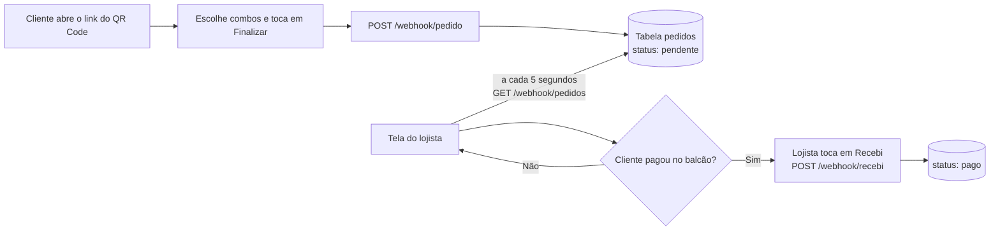
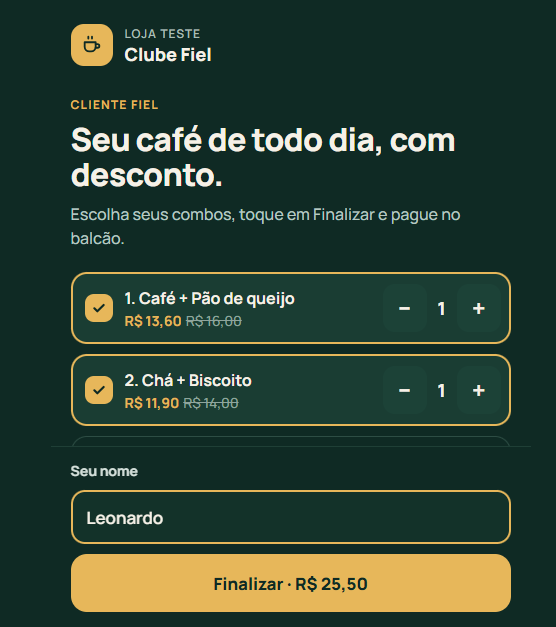
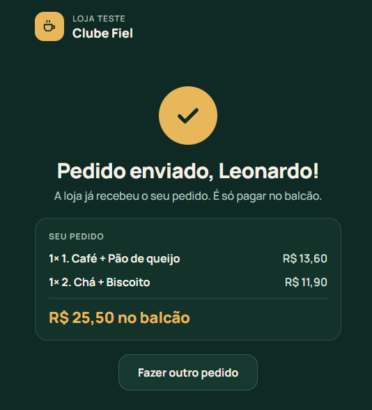
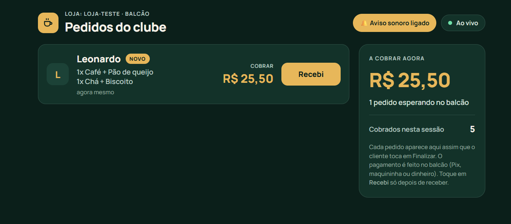

# Clube Fiel — pedidos com QR Code para cafés e lojas

> **English:** A simple loyalty and order system for small shops. A customer scans a QR code, picks discounted combos and taps *Finalize*. The shop sees the order on a computer screen in real time and marks it as paid at the counter. Built with n8n (webhooks + data table) and plain HTML/JavaScript.

Sistema simples de **fidelidade e pedidos** para pequenos comércios. O cliente abre um link (QR Code), escolhe combos com desconto e toca em **Finalizar**. O lojista vê o pedido na tela do computador, em tempo real, e marca como pago no balcão.

O sistema **não processa pagamento**: o cliente paga no balcão (Pix, maquininha ou dinheiro) e **não coleta dado pessoal** (só o primeiro nome).

## Como funciona

## Telas

**Cliente:** escolhe os combos, informa o nome e toca em Finalizar. Depois vê a confirmação.

  
  &nbsp;&nbsp;
  

**Lojista (balcão):** o pedido aparece sozinho em até 5 segundos, com aviso sonoro. Depois de receber o pagamento, o lojista toca em **Recebi**.

## O que tem aqui

| Pasta | Conteúdo |
|---|---|
| `telas/cliente.html` | Tela do cliente: 4 combos, quantidades, nome e botão Finalizar |
| `telas/lojista.html` | Tela do balcão: lista de pedidos pendentes, aviso sonoro e botão Recebi |
| `n8n/receber-pedido.json` | Fluxo que recebe o pedido e grava na tabela |
| `n8n/listar-pedidos.json` | Fluxo que devolve os pedidos pendentes |
| `n8n/marcar-como-pago.json` | Fluxo que troca o status do pedido para pago |
| `docs/` | Prints das telas usados neste README |

## Tecnologias

- **n8n** (Community Edition): webhooks e Data Tables (banco de dados embutido)
- **HTML, CSS e JavaScript** puros, sem biblioteca, com layout para celular
- **API REST** simples (JSON sobre HTTP)

## Como rodar no seu computador

1. Instale o [Node.js](https://nodejs.org) (versões 20.19 a 24.x) e, no terminal, rode `npx n8n`. O n8n abre em `http://localhost:5678`.
2. No n8n, crie uma **Data table** chamada `pedidos` com as colunas:

   | Coluna | Tipo |
   |---|---|
   | `nome` | texto |
   | `loja` | texto |
   | `combo` | número |
   | `qtd` | número |
   | `itens` | texto |
   | `total` | número (em centavos) |
   | `status` | texto (`pendente` ou `pago`) |

3. Importe os 3 arquivos da pasta `n8n/` (menu **⋯** do fluxo → **Import from file**). Em cada caixa **Data table**, selecione a sua tabela `pedidos`.
4. **Publique** os 3 fluxos (botão **Publish**).
5. Abra `telas/lojista.html` e `telas/cliente.html` no navegador, faça um pedido na tela do cliente e veja aparecer na tela do lojista.

## Status e limitações

Protótipo funcional, testado localmente. Ainda **não** está hospedado na internet.

- Os combos e preços do código são **exemplos**.
- O endereço do n8n (`localhost`) e o identificador da loja ficam no começo de cada arquivo HTML.
- A tela do lojista ainda não tem proteção por código, e o CORS do webhook está aberto (`*`). Isso é aceitável só em teste.
- O filtro por loja ainda é feito na tela, não no servidor.

## Próximos passos

- Hospedagem 24 horas e endereço público para o QR Code
- Proteção da tela do lojista por código
- Várias lojas no mesmo banco, com filtro no servidor

## Licença

Ainda não definida. Todos os direitos reservados ao autor por enquanto.
